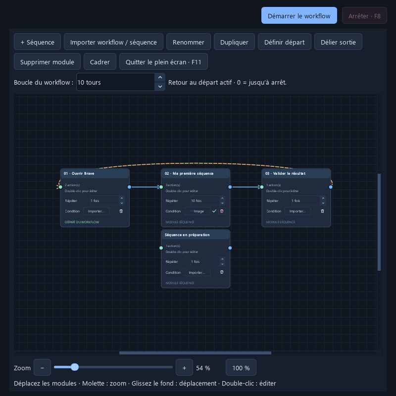

# Macro Studio

Éditeur visuel de macros pour Windows : créez des séquences de clics, de touches et de texte, puis reliez-les dans un workflow.

**Version 0.23.1 — préversion communautaire · Windows 10/11 x64 · Python 3.12 recommandé · Licence MIT**



## Fonctionnalités

- Éditeur sombre avec bibliothèque de blocs, séquence et propriétés.
- Clics souris, clavier, texte Unicode, attentes et défilement dans une zone choisie.
- Recherche d’images, attente de disparition d’un indicateur de chargement et conditions de démarrage par image sur chaque module.
- Workflow à plusieurs modules : répétitions, boucles, zoom et plein écran.
- Sauvegarde JSON, ouverture de documents récents et renommage des séquences.
- Gestion de popups pendant le workflow, pause de sécurité et arrêt par **F8**.
- Widget flottant de suivi avec compteurs et mode réduit en icône.
- Notifications Discord avec mention, boutons Arrêter/Reprendre via un bot optionnel et comptes rendus OCR.

Les cibles doivent être visibles à l’écran. La recherche d’image dépend de l’échelle, du thème et de la résolution. Le logiciel utilise la souris et le clavier du PC : commencez avec un workflow de test et gardez F8 accessible.

## Lancer depuis les sources

Installez Python 3.12 64 bits sur Windows. Dans PowerShell, depuis le dossier du projet :

```powershell
py -3.12 -m venv .venv
.\.venv\Scripts\python.exe -m pip install --upgrade pip
.\.venv\Scripts\python.exe -m pip install -e ".[test]"
.\.venv\Scripts\python.exe -m macro_studio
```

`start.bat` peut ensuite lancer l’application. Aucune clé Discord n’est nécessaire pour utiliser les macros. L’OCR utilise les langues de reconnaissance installées dans Windows.

## Premier workflow

1. Ajoutez des actions dans une séquence et réglez leurs propriétés.
2. Dans Workflow, ajoutez vos modules et reliez leur sortie à l’entrée du suivant.
3. Réglez les répétitions ; si nécessaire, importez une image sur la ligne **Condition** d’un module. La coche verte indique qu’une image est configurée. Sans image, le module démarre normalement ; avec image, il vérifie sa présence toutes les 3 secondes.
4. Enregistrez le workflow puis lancez-le. Le délai initial vous laisse placer la fenêtre cible au premier plan.
5. Utilisez Pause/Reprendre ou **F8** pour arrêter. Le bouton Réduire du suivi conserve l’exécution en cours.

## Discord

Les alertes par webhook sont facultatives. Une mention nécessite un identifiant utilisateur Discord ; les deux boutons de commande nécessitent aussi un bot. Consultez [DISCORD.md](DISCORD.md) pour la configuration. Les secrets restent dans les réglages du compte Windows et ne sont pas stockés dans les workflows.

## Tests et compilation

```powershell
$env:QT_QPA_PLATFORM = "offscreen"
.\.venv\Scripts\python.exe -m pytest -q
```

La référence locale est **375 tests réussis**, avec réseau Discord et entrées souris/clavier simulés. Le test OCR Windows utilise une image synthétique. La validation GitHub Actions de la version initiale a également réussi.

La construction de l’installateur et du ZIP portable est décrite dans [BUILD_WINDOWS.md](BUILD_WINDOWS.md). Les composants tiers et leurs licences doivent accompagner les distributions binaires.

## État de la préversion

Les sources et les tests locaux sont disponibles. Les binaires 0.23.1 ne sont pas signés. Leur lancement et leur installation n’ont pas été revalidés sur la machine de préparation, après un blocage de contrôle d’application Windows (erreur 4551) avec une version précédente. La validation sur une machine Windows propre et sur un serveur Discord réel reste à effectuer. Aucun réglage de sécurité Windows n’a été modifié.

Les tests réussis ne constituent pas une validation de ces binaires. Les publications binaires doivent rester marquées **Pre-release** tant que ces vérifications ne sont pas terminées.

## Participer

Lisez [CONTRIBUTING.md](CONTRIBUTING.md) pour proposer un correctif ou signaler un problème. Ne joignez pas vos workflows personnels ou vos jetons Discord à une issue. Les signalements sensibles sont décrits dans [SECURITY.md](SECURITY.md).

## Licence

Le code propre à Macro Studio est sous [licence MIT](LICENSE). Les dépendances conservent leurs licences respectives, notamment PySide6/Qt et les composants distribués dans `Licences` lors de la compilation. Voir [THIRD_PARTY_NOTICES.md](THIRD_PARTY_NOTICES.md).
